# DSO202 Practical 4: GitOps Continuous Delivery with Argo CD on Kind

---

## 1. Objective

The aim of this practical was to deliver a small web application to Kubernetes using GitOps instead of running `kubectl apply` by hand or from a CI pipeline. In the traditional push model, an external tool holds cluster credentials, applies YAML once and then stops caring, so manual changes and failures after deployment go unnoticed. In the pull model used here, an agent inside the cluster (Argo CD) continuously compares the cluster with a Git repository and corrects any difference, which makes Git the single source of truth

By the end of the practical I was able to:

- install Argo CD into its own namespace and identify its three main components;
- register an application declaratively with an Argo CD `Application` custom resource instead of the web UI;
- change the running application only through Git commits;
- observe self-healing when the cluster was changed manually with `kubectl`;
- observe automatic pruning when a manifest was deleted from Git, and roll the deletion back with `git revert`;
- diagnose and fix several real installation and synchronisation problems along the way.

---

## 2. Environment

| Item | Value |
|---|---|
| Host operating system | Pop!_OS (Linux) |
| Docker | 27.4.0 (Docker VM limited to 3.65 GiB RAM) |
| kind | v0.32.0 |
| kubectl (client) | v1.37.1 (Kustomize v5.8.1) |
| Kubernetes (cluster) | v1.36.1 |
| Node OS and runtime | Debian GNU/Linux 13 (trixie), containerd 2.3.1 |
| Argo CD | v3.6.1 (`quay.io/argoproj/argocd:v3.6.1`) |
| Cluster name and context | `dso202-p4`, `kind-dso202-p4` |
| Application image | `nginxdemos/hello:plain-text` |
| Git repository | `https://github.com/NamgyelHuk708/dso202-gitops-demo` (path `manifests`) |
| Argo CD UI | `https://localhost:8888` (port-forward; 8080 was already in use) |

The cluster has one control-plane node and two workers, named `control-plane`, `worker-node-1` and `worker-node-2` through the kubeadm configuration patches in `cluster/kind-cluster.yaml`, the same way as in earlier practicals.

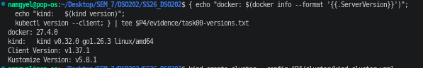

*Figure 1: Tool versions used in this practical (`evidence/task00-versions.txt`).*

---

## 3. Procedure and Observations

### 3.1 Repository layout

```
dso202-gitops-demo/
├── README.md                 this report
├── manifests/                the ONLY folder Argo CD watches (desired state)
│   ├── deployment.yaml
│   └── service.yaml
├── argocd/
│   └── argocd-app.yaml       Argo CD Application (registered with kubectl apply)
├── cluster/
│   └── kind-cluster.yaml     three-node kind cluster
├── evidence/                 text output saved during the lab
└── images/                   screenshots
```

**Why a separate repository.** I first pointed Argo CD at a subfolder of my course repository (`SS26_DSO202`, path `dso202-practical-04/manifests`). The application stayed at Sync status `Unknown` with a `ComparisonError`, because the repo-server has to fetch the **whole** repository, including every screenshot from earlier practicals, and on my connection the fetch kept failing (section 4, issue 4). This is exactly the situation the lab's Golden Rule (section 2.1) warns about, so I moved the manifests into this small dedicated repository; the course repository now only contains a link here.

`argocd-app.yaml` is deliberately kept outside `manifests/` so that Argo CD does not try to manage its own `Application` object. The screenshots, evidence and this report were committed only **after** the experiments, so during the lab the repository Argo CD fetched contained little more than the two manifests (the first push was 1.84 KiB).

The Application used for the whole practical:

```yaml
apiVersion: argoproj.io/v1alpha1
kind: Application
metadata:
  name: my-webapp
  namespace: argocd
spec:
  project: default
  source:
    repoURL: https://github.com/NamgyelHuk708/dso202-gitops-demo.git
    targetRevision: main
    path: manifests
  destination:
    server: https://kubernetes.default.svc
    namespace: demo-app
  syncPolicy:
    automated:
      prune: true
      selfHeal: true
    syncOptions:
      - CreateNamespace=true
```

### 3.2 Creating the cluster

```bash
kind create cluster --config cluster/kind-cluster.yaml
kubectl get nodes -o wide
```

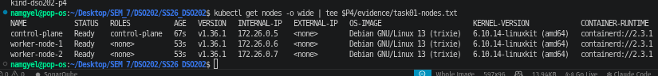

*Figure 2: Three nodes in the `Ready` state.*

All three nodes were `Ready` about a minute after creation, running Kubernetes v1.36.1 on Debian 13 with containerd 2.3.1. Before going further I checked that `kubectl config current-context` returned `kind-dso202-p4`. This mattered because my first attempt ran from the wrong directory, the cluster was not created, and `kubectl` was still pointing at a different cluster I use for another course, so any Argo CD install at that point would have gone to the wrong place.

### 3.3 Installing Argo CD

```bash
kubectl create namespace argocd
kubectl apply -n argocd -f https://raw.githubusercontent.com/argoproj/argo-cd/stable/manifests/install.yaml
```

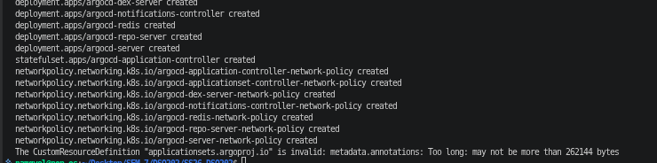

*Figure 3: The plain `kubectl apply` created every object except the `applicationsets.argoproj.io` CRD.*

The install created the service accounts, RBAC rules, ConfigMaps, Services, Deployments, the application-controller StatefulSet and the network policies, but the `applicationsets.argoproj.io` CRD was rejected with `metadata.annotations: Too long: may not be more than 262144 bytes`. Re-running the same install with server-side apply fixed it (section 4, issue 1):

```bash
kubectl apply -n argocd --server-side --force-conflicts -f https://raw.githubusercontent.com/argoproj/argo-cd/stable/manifests/install.yaml
```

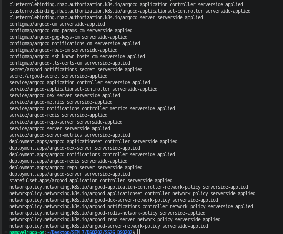

*Figure 3b: Server-side apply completing the installation.*

The first `kubectl wait` timed out on five pods. The events showed that the 229 MB `argocd` image took almost three minutes to pull, and Docker was also running another kind cluster in only 3.65 GiB of RAM. After deleting the unused cluster, the core components came up (section 4, issue 2).

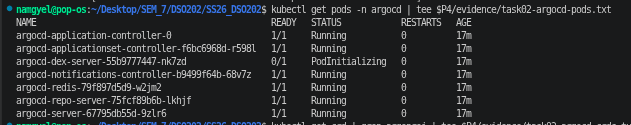

*Figure 4: Argo CD pods in the `argocd` namespace.*

The three components that matter for this lab were all `Running`:

- **`argocd-server`** serves the web UI and the API used by the CLI.
- **`argocd-repo-server`** clones the Git repository and renders the files in it (plain YAML here; Helm or Kustomize in general) into Kubernetes manifests.
- **`argocd-application-controller`** is the reconciliation engine: it asks the repo-server for the desired state, asks the Kubernetes API for the live state, marks the application `OutOfSync` when they differ and, with automated sync, applies the fix.

`argocd-dex-server` stayed in `PodInitializing` for a long time. Dex is only used for single sign-on (GitHub, Google and so on); logging in as `admin` does not need it, so it did not affect the lab.

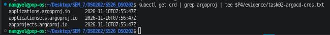

*Figure 5: Custom Resource Definitions added by Argo CD.*

Three CRDs were registered: `applications`, `applicationsets` and `appprojects`. The `applicationsets` CRD has a creation time one minute later than the other two, which is visible proof of the server-side re-apply. These CRDs are what "teach" the Kubernetes API the new word `kind: Application`. Argo CD then behaves like any built-in controller: just as the ReplicaSet controller loops on "desired pods vs actual pods", the application controller loops on "desired state in Git vs actual state in the cluster".

### 3.4 Accessing the UI

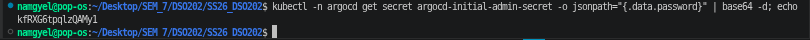

*Figure 6: Decoding the initial admin password from `argocd-initial-admin-secret` (password hidden).*

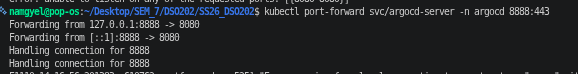

*Figure 7: Port 8080 already in use, so `svc/argocd-server` was forwarded to `localhost:8888` instead.*

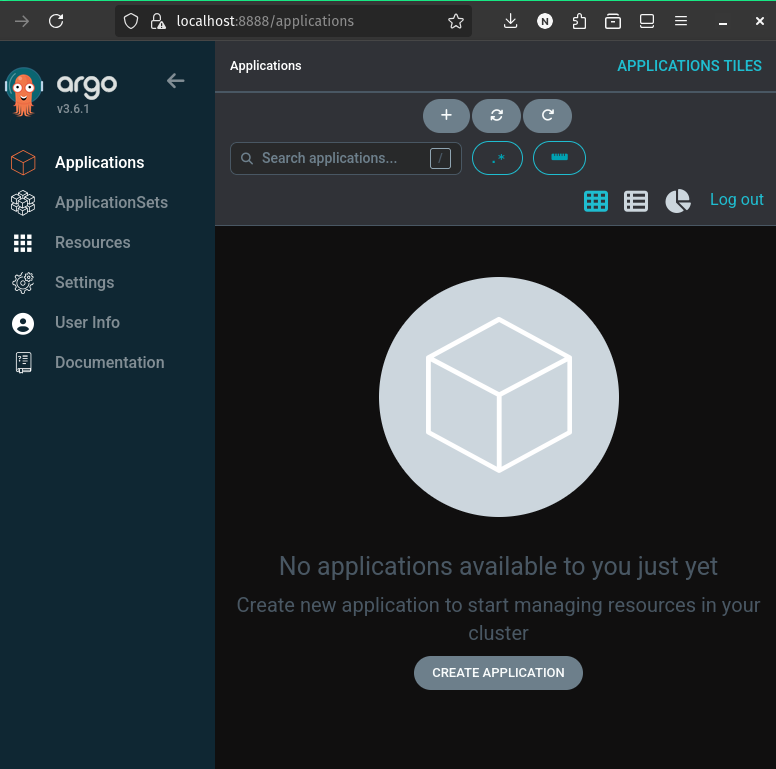

*Figure 8: Argo CD dashboard after login, before any application is registered.*

The `argocd-server` Service is a `ClusterIP`, so it is not reachable from outside the cluster; `kubectl port-forward` is the simplest way in on a kind cluster. Port 8080 was taken by another process on my laptop, so I used `8888:443` (section 4, issue 3). The browser warned about the connection because Argo CD ships with a self-signed TLS certificate.

### 3.5 Pushing the desired state to Git

Only the manifests, the Application and the cluster config were pushed first; `README.md`, `evidence/` and `images/` were deliberately left untracked to keep the repository tiny while Argo CD was fetching it.

```
$ git add manifests argocd cluster
$ git commit -m "Initial deployment with 2 replicas"
[main (root-commit) 60d9890] Initial deployment with 2 replicas
 4 files changed, 105 insertions(+)
$ git push -u origin main
Writing objects: 100% (9/9), 1.84 KiB | 941.00 KiB/s, done.
 * [new branch]      main -> main
```

The first push attempt failed with `Could not resolve host: github.com`, and `ping github.com` then showed 33 % packet loss. My connection was unstable during the session, which also explains the Argo CD fetch problems in section 4.

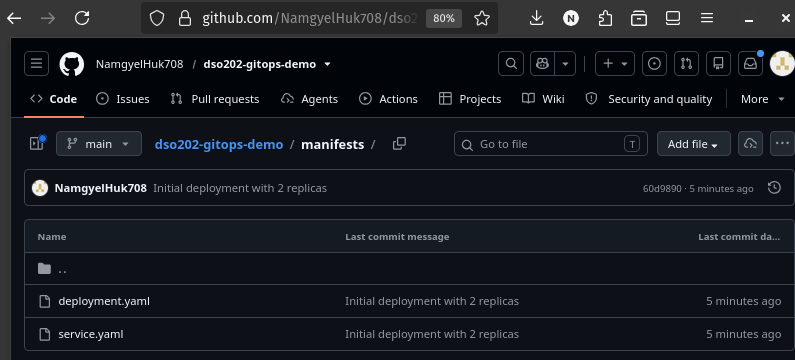

*Figure 10: The `manifests` folder in `dso202-gitops-demo` on GitHub, the desired state Argo CD reads.*

### 3.6 Registering the Application declaratively

```bash
kubectl apply -f argocd/argocd-app.yaml
```

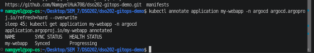

*Figure 11: Applying the `my-webapp` Application and its status in the terminal.*

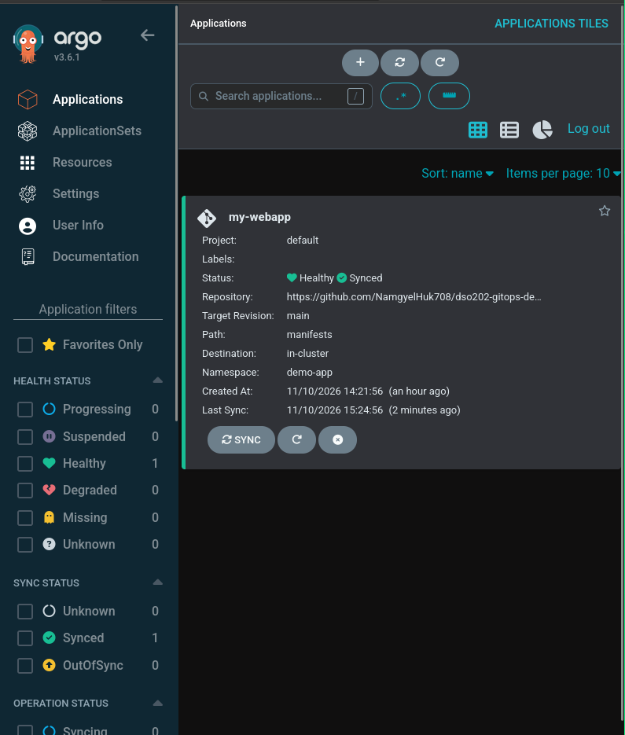

*Figure 12: `my-webapp` tile: Healthy and Synced, repository `dso202-gitops-demo`, path `manifests`.*

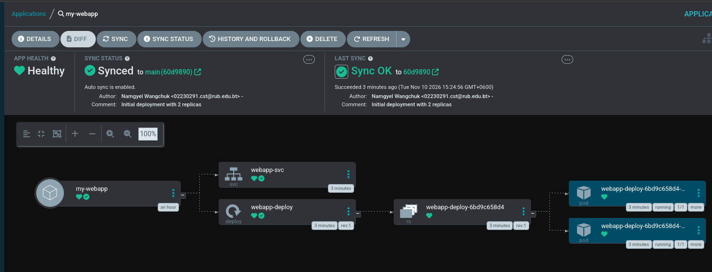

*Figure 13: Resource tree: Service, Deployment, ReplicaSet and two Pods.*

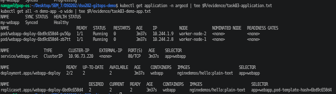

*Figure 14: `kubectl` view of the application and of everything in `demo-app`.*

I never ran `kubectl apply` on the Deployment or the Service. Argo CD created the `demo-app` namespace (because of `CreateNamespace=true`), `webapp-deploy` and `webapp-svc` (ClusterIP `10.96.73.220`) directly from Git, with the first sync initiated by the automated sync policy at 15:24:56. The two pods were spread across both workers: `pv56p` on `worker-node-2` and `zb7tt` on `worker-node-1`.

The status first read `Synced  Progressing` and a few seconds later `Synced  Healthy`. The cluster already matched Git, but the pods were still starting, which is a small real example of sync status and health being two independent questions (section 5.2).

### 3.7 Experiment 1: Git as the single source of truth (2 → 4 replicas)

The only change made was one line in Git:

```
$ git diff manifests/deployment.yaml
 spec:
-  replicas: 2
+  replicas: 4
$ git commit -m "Scale webapp to 4 replicas" manifests/deployment.yaml
[main f927e65] Scale webapp to 4 replicas
$ git push origin main
   60d9890..f927e65  main -> main
```

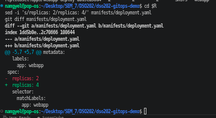

*Figure 15: `git diff` of the only change made: `replicas: 2` → `replicas: 4`.*

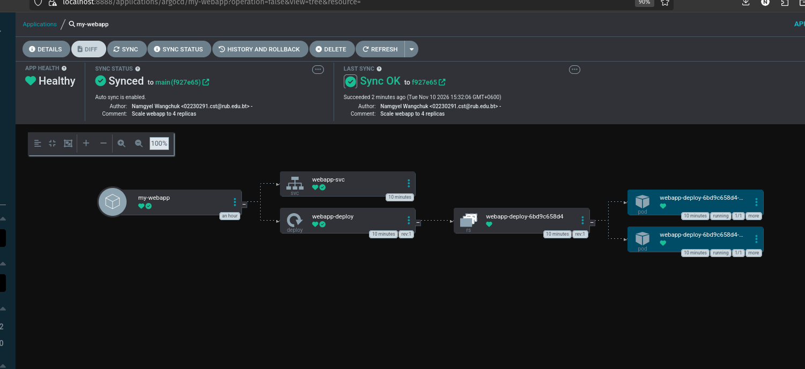

*Figure 16: Argo CD synced to `main (f927e65)`, "Scale webapp to 4 replicas", with four Pods in the tree.*

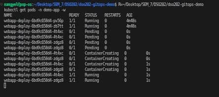

*Figure 17: Live watch of the two new Pods (`4t4xc`, `zdgz8`) going from `Pending` to `Running` in about one second.*

The commit was authored at 15:30:18 and, after I clicked **Refresh**, synced at 15:32:06 by the **automated sync policy**. The sync result listed `deployment.apps/webapp-deploy configured` and `service/webapp-svc unchanged`, so Argo CD only touched the object that actually differed. The commit hash shown in the UI matched `git log`.

Without Refresh, Argo CD would have noticed the commit on its next poll (every 3 minutes by default). A GitHub webhook would make this instant, but GitHub cannot reach a laptop-local cluster, so Refresh was the practical choice. Once, the browser kept showing two pods even though `kubectl` already showed four; reloading the page fixed it, so it was a stale view rather than a sync problem.

### 3.8 Experiment 2: Configuration drift and self-healing

Acting as a "rogue admin", I bypassed Git and scaled the Deployment by hand:

```bash
kubectl scale deployment webapp-deploy -n demo-app --replicas=1
```

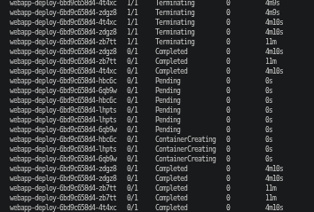

*Figure 19: Live watch: three Pods terminating, then three replacements created.*

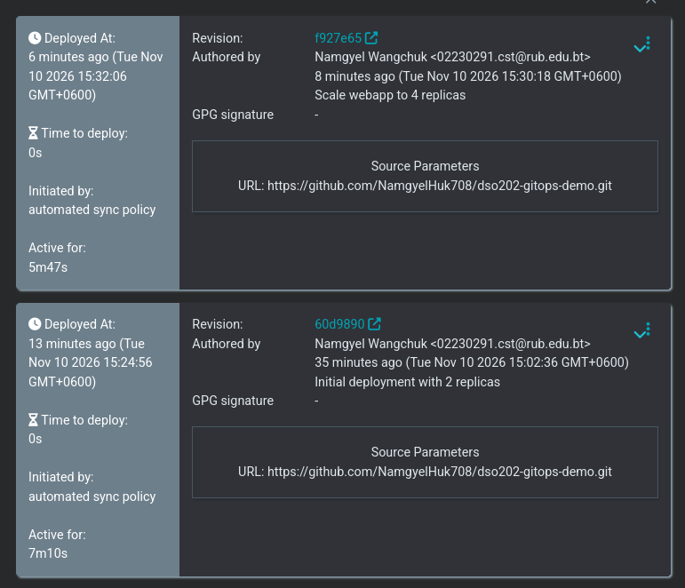

*Figure 20: Four Pods again; three of them only seconds old, plus the events showing the scale-down.*

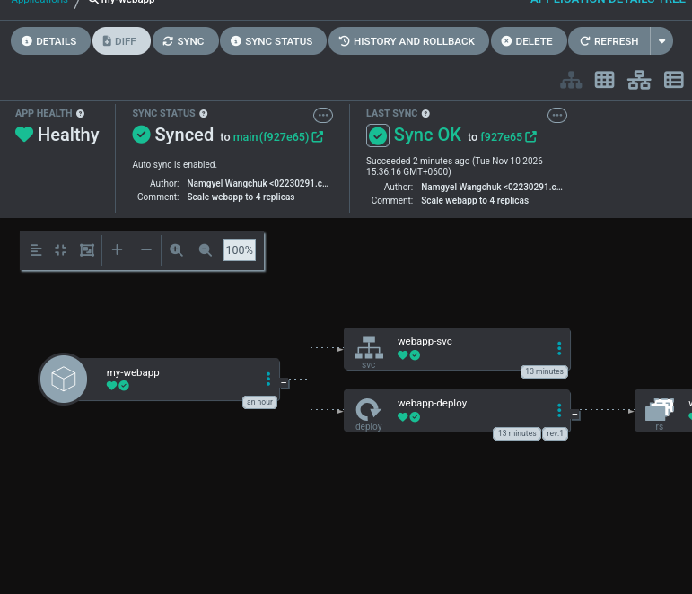

*Figure 21: Application back to Synced and Healthy; Last Sync at 15:36:16 for the same revision `f927e65`.*

The events show exactly what happened. The manual command made the ReplicaSet scale down from 4 to 1, deleting `zb7tt`, `4t4xc` and `zdgz8`. Argo CD saw that the live replica count (1) no longer matched Git (4) and, because `selfHeal: true` is set, synced again on its own. Three new pods (`6qb9w`, `hbc6c`, `lhpts`) went from `Pending` to `Running` within about one second, and the Deployment was back to `4/4`. Only `pv56p` survived the whole sequence. The status flipped to `OutOfSync` and back so quickly that I could not capture it in the UI, but the watch output and the events record it.

The self-heal sync was to the **same revision** `f927e65`. No new commit was needed, because Argo CD was simply enforcing what Git already said. In a push-based pipeline, this manual change would have stayed in place unnoticed until the next deployment.

### 3.9 Experiment 3: Automatic pruning

I deleted the Service manifest from Git:

```bash
git rm manifests/service.yaml
git commit -m "Remove webapp service (prune test)"
git push origin main
```

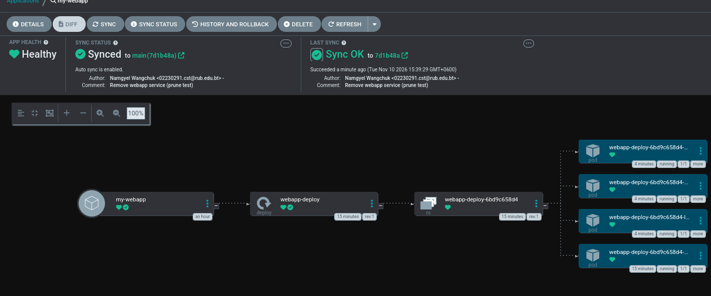

*Figure 23: Synced to `7d1b48a`, "Remove webapp service (prune test)": `webapp-svc` is gone, the Deployment and its four Pods are untouched.*

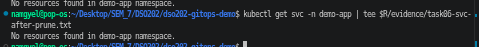

*Figure 24: `kubectl get svc -n demo-app` confirming the Service was deleted.*

Argo CD synced commit `7d1b48a` at 15:39:29 and deleted `webapp-svc` from the cluster. Right after the sync, the tree briefly still showed the Service, but without its sync tick (no longer tracked); a page reload showed it removed. Without `prune: true`, Argo CD would only have flagged the Service as an extra resource and left it running, which is the safe default to avoid accidental deletions.

### 3.10 Rollback with git revert

```bash
git revert --no-edit HEAD
git push origin main
```

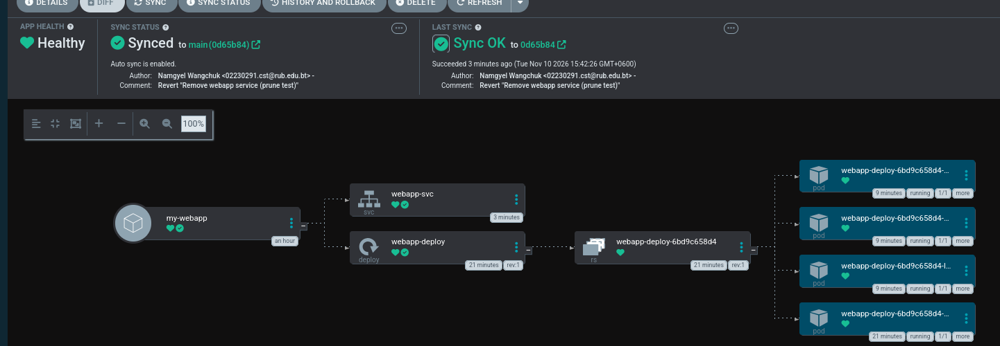

*Figure 26: Synced to `0d65b84`, "Revert "Remove webapp service (prune test)"": `webapp-svc` restored.*

Argo CD synced the revert commit at 15:42:26 and recreated `webapp-svc`. The tree shows the Service as 3 minutes old while the Deployment is 21 minutes old: it is a brand-new object built from Git, not the old one coming back. The rollback was done without touching the cluster, and nothing was erased from history: Git now records both the deletion and the revert as separate commits.

### 3.11 Final state

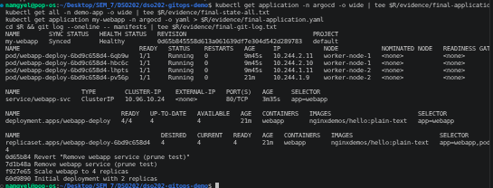

*Figure 27: Final `kubectl` state: application Synced/Healthy, four Pods, Service present, and the commit history.*


*Figure 28: Final Argo CD resource tree.*

Audit trail of every change made to the application (`evidence/final-git-log.txt`):

```
0d65b84 Revert "Remove webapp service (prune test)"
7d1b48a Remove webapp service (prune test)
f927e65 Scale webapp to 4 replicas
60d9890 Initial deployment with 2 replicas
```

Every change to the running application is one commit with an author, a time and a message. The only change that does not appear here is the manual `kubectl scale`, and that is precisely the one Argo CD undid.

### 3.12 Cleanup

```bash
kind delete cluster --name dso202-p4
```

---

## 4. Troubleshooting

| # | Phase | Symptom | Cause | Resolution | Evidence |
|---|---|---|---|---|---|
| 1 | Install | `The CustomResourceDefinition "applicationsets.argoproj.io" is invalid: metadata.annotations: Too long` | Client-side `kubectl apply` stores the whole object in the `last-applied-configuration` annotation, which exceeds the 256 KB limit for this large CRD | Re-applied with `--server-side --force-conflicts`, which tracks fields on the server and does not write that annotation | Figures 3, 3b, 5 |
| 2 | Install | `kubectl wait` timed out on five Argo CD pods; `argocd-server` readiness probe failed | The 229 MB `argocd` image took about 3 minutes to pull, and Docker had only 3.65 GiB RAM shared with another kind cluster and other containers | Deleted the unused `dso202-a3` cluster and waited; all core pods became Ready. `argocd-dex-server` (SSO only) is not needed for admin login | Figure 4 |
| 3 | UI access | `bind: address already in use` on port 8080 | Another local process was already listening on 8080 | Port-forwarded to `8888:443` and used `https://localhost:8888` | Figure 7 |
| 4 | Registration | App stuck at Sync `Unknown`, App Conditions `1 Error`: `ComparisonError ... DeadlineExceeded` | The repo-server must fetch the whole course repository; `git fetch` failed with `early EOF` after 58.7 s, then with `timeout after 1m30s` on every retry, on an unstable connection | Raised `controller.repo.server.timeout.seconds` and `server.repo.server.timeout.seconds` to 300 in `argocd-cmd-params-cm`; when the git command itself still hit its own 90 s limit, moved the manifests to this small dedicated repository and re-pointed the Application | Section 3.1 |
| 5 | Git push | `Could not resolve host: github.com` | Unstable internet (33 % packet loss to GitHub) | Retried the push once the connection recovered | Section 3.5 |
| 6 | UI | Tree showed 2 Pods (and later a deleted Service) although `kubectl` already showed the new state | Stale browser view | Reloaded the page; always confirmed with `kubectl` | Figures 16, 23 |

Relevant repo-server log lines for issue 4:

```
`git fetch origin --tags --force --prune` failed signal: terminated: fatal: early EOF   (58693 ms)
`git fetch origin --tags --force --prune` failed timeout after 1m30s
```

---

## 5. Analysis

### 5.1 Push-based CI/CD compared with GitOps

| Aspect | Push (CI runs `kubectl apply`) | Pull (Argo CD in the cluster) |
|---|---|---|
| Cluster credentials | Held by an external CI server | Stay inside the cluster |
| After deployment | CI stops watching | Continuous comparison with Git |
| Manual `kubectl` changes | Go unnoticed (drift) | Detected and reverted in seconds (Experiment 2) |
| Deleting a resource | Must be scripted separately | Delete the file; prune removes it (Experiment 3) |
| Rollback | Re-run an old pipeline | `git revert` (section 3.10) |
| Audit | Pipeline logs | `git log` on the manifests (section 3.11) |

### 5.2 Sync status and health status

Sync status answers "does the cluster match Git?", while health answers "is the application actually working?". They are independent. I saw `Synced` with `Progressing` right after registration: the objects matched Git but the pods were still starting. The opposite case would be `OutOfSync` with `Healthy`, as in the instant after my manual scale-down, when one pod was still serving traffic but the replica count no longer matched Git. A wrong image tag pushed to Git would give `Synced` with `Degraded`: Argo CD faithfully applies what Git says, but the pods fall into `ImagePullBackOff`. So a green sync badge alone does not mean the application works.

### 5.3 The four GitOps principles in this practical

- **Declarative:** the whole desired state, including how Argo CD itself should treat the app, is written as YAML (`manifests/` and `argocd/argocd-app.yaml`); there are no step-by-step scripts.
- **Versioned and immutable:** every change is a commit with a hash, author and time (`60d9890`, `f927e65`, `7d1b48a`, `0d65b84`), and the rollback added a commit instead of rewriting history.
- **Pulled automatically:** Argo CD fetched changes from GitHub itself (on poll or Refresh); nothing outside the cluster needed cluster credentials.
- **Continuously reconciled:** the self-heal in Experiment 2 corrected a manual change within seconds, and the prune in Experiment 3 removed a resource that no longer existed in Git.

### 5.4 Why the configuration repository should be small and separate

The lab explains the Golden Rule mainly with CI loops, audit trails and access control. My practical added a very practical reason: Argo CD fetches the entire repository, history included, not just the folder in `path:`. A course repository full of screenshots was too heavy to fetch within Argo CD's limits on an unstable connection, while a manifests-only repository of a few kilobytes synced every time. In a real team, the configuration repository would also contain no report or images at all.

### 5.5 Limitations of this setup

The report, images and manifests share one repository here; in a real project the configuration repository would hold only manifests. Changes were detected by polling and the Refresh button rather than a webhook. Login used the initial admin password from a Secret, which should be rotated and replaced with SSO in practice. Finally, this application has no secrets; real ones could not be committed to Git as plain or base64-encoded Secrets and would need a tool such as Sealed Secrets or the External Secrets Operator.

---

## 6. Reflection

Before this practical, I saw `kubectl apply` as the normal way to change a cluster. Here, `kubectl` became a read-only tool for checking what Argo CD had done, and every real change went through a commit. The part that surprised me most was how fast self-healing was: my manual scale-down was undone in about a second, which made it very clear that in GitOps the cluster belongs to Git and not to whoever has `kubectl` access.

The problems I ran into were as useful as the experiments. The oversized CRD, the slow image pulls and especially the repository that was too big to fetch all taught me to read Argo CD's conditions and repo-server logs instead of guessing, and the last one showed me in practice why the configuration repository should be separate and small. As a next step, I would like to point Argo CD at the Kustomize overlays from Practical 5 or the Helm chart from Practical 6 to manage several environments, and try the App of Apps pattern.

---

## 7. References

- Argo CD documentation, *Getting Started*: https://argo-cd.readthedocs.io/en/stable/getting_started/
- Argo CD documentation, *Automated Sync Policy*: https://argo-cd.readthedocs.io/en/stable/user-guide/auto_sync/
- Argo CD documentation, *argocd-cmd-params-cm*: https://argo-cd.readthedocs.io/en/stable/operator-manual/argocd-cmd-params-cm-yaml/
- Kubernetes documentation, *Server-Side Apply*: https://kubernetes.io/docs/reference/using-api/server-side-apply/
- OpenGitOps, *GitOps Principles v1.0.0*: https://opengitops.dev/
- kind documentation: https://kind.sigs.k8s.io/
- DSO202 lab guide, *GitOps and Argo CD Lab Guide* (HackMD).